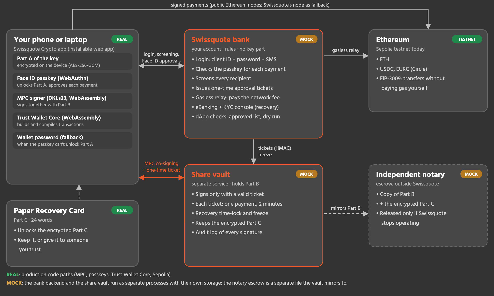

# Swissquote Wallet

A self-custody wallet Swissquote could launch for its clients: **their keys, their control**. Trust Wallet Core builds every transaction, the key is a 2-of-3 MPC key that never exists in one place, Face ID (passkeys) approves payments, and Swissquote pays the network fee for USDC and EURC. Runs on Ethereum Sepolia.

**Step-by-step guide (computer and iPhone): [`GUIDE.md`](GUIDE.md).** Hackathon submission summary: [`SUBMISSION.md`](SUBMISSION.md).

The challenge: [`docs/challenge-brief.md`](docs/challenge-brief.md). No crypto background? [`docs/handbook.md`](docs/handbook.md).



## How it works

**The key never exists in one place.** It is created as a 2-of-3 MPC key (DKLs23, Silence Laboratories) in three parts:

| Part | Held by | Role |
|---|---|---|
| **A** | The client's device, encrypted with its passkey (WebAuthn PRF) or a wallet password. Identical copies on the client's other devices (**Add a device** by QR link) | Signs every payment together with B |
| **B** | Swissquote's Share Vault, a separate service; a copy with an independent notary escrow | Co-signs only the exact hash the bank approved: after screening the real recipient and the client's passkey approval (plus SMS for high values) |
| **C** | Encrypted under the client's **paper Recovery Card** (24 words); the ciphertext is kept by the vault, the notary escrow, each device and the backup file | Recovery, and paying without Swissquote together with A |

Any two parts sign. Trust Wallet Core builds every transaction and computes its hash; the bank rebuilds the same hash itself before it lets the vault co-sign, and Trust Wallet Core compiles the signature into the final transaction. **Gasless USDC and EURC**: the client signs an EIP-3009 authorization (also co-signed A + B) and Swissquote's treasury submits it and pays the fee, up to `RELAY_DAILY_LIMIT` transfers per client and day.

Losing a device: remove it from another device (Settings → Devices); Swissquote stops accepting its passkey, so its copy of Part A can no longer get Swissquote's co-signature. Losing everything: identity check (KYC selfie) and a time-lock the real client can cancel, then the part the client still has (synced passkey or backup file for A, paper card for C) and the vault refresh **all three parts**: same address, a new card, and old parts (also on a lost device) stop working with Swissquote. If Swissquote ceases operations, the notary escrow releases its copy of Part B and `tools/emergency-recover.mjs` moves the funds with any two parts, offline from Swissquote.

There are no 24 seed words to export: that would put the whole key in one place. Wallets created with the earlier Shamir version of this app can't be used: run `npm run reset` once (the vault warns at startup).

## Submission checklist

| Brief asks for | Where |
|---|---|
| End-to-end story: create → log in and sign → lose → recover | The app; [`GUIDE.md`](GUIDE.md) sections 4, 6, 9; `npm run test:browser` runs it automatically |
| Transaction signed and sent to a blockchain | Ethereum Sepolia: ETH, USDC, EURC payments, gasless transfers, WETH via Apps ([`GUIDE.md`](GUIDE.md) section 6) |
| 1. Custody model, pros/cons, threat model, Swissquote alone or with a partner | [`docs/custody-model.md`](docs/custody-model.md), [`docs/threat-model.md`](docs/threat-model.md) |
| 2. Architecture diagram, real vs. mocked | [`docs/architecture.md`](docs/architecture.md) (diagram above), [Real vs. mocked](#real-vs-mocked) |
| 3. Wallet creation: where parts are generated and live, link to identity | [How it works](#how-it-works), [`docs/architecture.md`](docs/architecture.md) "Create" |
| 4. Authentication, high value vs. small | Passkey (Face ID) bound to each payment; SMS code from CHF 1,000 (CHF 20 on the testnet); wallet password fallback. [`docs/architecture.md`](docs/architecture.md) "Pay" |
| 5. Recovery: who, how long, attacker, Swissquote gone | [`docs/threat-model.md`](docs/threat-model.md); bonus: attacker with the stolen phone and e-mail refused ([`GUIDE.md`](GUIDE.md) section 10) |
| 6. Business case | [`docs/business-case.md`](docs/business-case.md) |
| Custody and Travel Rule (legal primer) | [`docs/legal-compliance.md`](docs/legal-compliance.md) |
| Bonus topics | [Bonus topics](#bonus-topics) |
| AI tools used | [`pitch/ai-tools.md`](pitch/ai-tools.md) |
| No homemade cryptography | DKLs23 (Silence Laboratories), Trust Wallet Core, WebAuthn/SimpleWebAuthn, WebCrypto, ethers |
| Mocked share holder: separate process, own storage, app never holds its share | `share-vault/` runs as its own process with `share-vault/data/`; the app never receives Part B |

## Bonus topics

**Gasless transactions.** Clients send USDC and EURC without owning ETH. The wallet MPC-signs an EIP-3009 `transferWithAuthorization` (EIP-712 typed data: recipient, amount, 10-minute validity, random nonce); Swissquote's treasury submits it and pays the gas.
- *Who pays:* Swissquote, from its fee account; funded by the recovery subscription.
- *Abuse prevention:* 10 sponsored transfers per client per day; the recipient is screened first; only the exact authorization the client approved with Face ID is relayed, after a simulation; authorizations expire within an hour and their nonce can be used once; the fee account's balance is checked before the client approves.

**Compliant dApp interaction.** The **Apps** screen lets clients use DeFi (wrap ETH into WETH, the token Uniswap uses) without exposing them or Swissquote to scams and sanctions:
- approved dApp list; calls to any other contract are refused;
- Swissquote decodes the request and only allows functions it understands;
- a dry run on the network before signing, with the effects in plain language ("0.01 ETH leaves your wallet, 0.01 WETH arrives");
- token approvals only to approved dApps (Uniswap Permit2) and never unlimited;
- sanctions screening of the contract and of any spender; Face ID + SMS from the high-value threshold.
Two demo buttons show a scam request (unlimited USDC approval, unknown contract) being refused before anything is signed.

## Run it

Node.js 22 or newer and a browser with passkeys (Chrome, Edge or Safari). From the repository root:

```bash
npm install         # once: installs wallet-app, bank-server and share-vault (npm workspaces)
npm run demo        # share vault + bank server + wallet app
```

Open **http://localhost:5173**. Demo logins: `SQ-100234` / `Demo-1234` (Anna Keller) and `SQ-100777` / `Demo-5678` (Marco Rossi); the SMS code is shown in the app. The mock eBanking portal is at http://localhost:4000/portal/, the KYC operator console at http://localhost:4000/portal/kyc.html (PIN `kyc-demo`).

| Command | What it does |
|---|---|
| `npm run demo:fast` | Same demo with short time-locks: recovery 15 s (default 90 s, production 72 h), fraud freeze 60 s |
| `npm run status` | Health of bank, vault and app; network, treasury address and balance |
| `npm run kyc` | List recoveries waiting for identity verification; `npm run kyc -- approve` or `-- reject` decides the latest |
| `npm run reset` | With the demo stopped: delete client records, vault shares and escrow copy; keeps the treasury key |
| `npm test` | End-to-end API test against the running demo: MPC key generation, payments, gasless, dApps, devices, recovery, emergency tool (real MPC library, Trust Wallet Core, Sepolia RPC; needs a reset demo) |
| `npm run test:browser` | Browser end-to-end test in Chrome with a virtual passkey; best with `npm run demo:fast` on reset data |
| `npm run recover-offline -- …` | Emergency recovery without Swissquote: any two parts move all ETH/USDC/EURC to a new address; run without arguments for usage |
| `npm run tunnel` | Public HTTPS link to the app for phones (cloudflared) |

The bank treasury is a Sepolia account whose key is created in `bank-server/data/treasury.json` on first start. It pays bank → wallet top-ups and the network fee of gasless USDC/EURC transfers. `npm run status` prints its address; fund it with Sepolia ETH from a faucet. Test USDC and EURC for wallets: https://faucet.circle.com (Ethereum Sepolia). Runtime data (`bank-server/data/`, `share-vault/data/`) is git-ignored: it holds key parts and the treasury key.

Settings (environment variables): `CHAIN` (`sepolia` or `mainnet`; gasless only on Sepolia), `SEPOLIA_RPC_URL`, `BANK_PORT`, `VAULT_PORT`, `APP_PORT`, `RECOVERY_DELAY_SECONDS`, `FREEZE_SECONDS`, `RELAY_DAILY_LIMIT`, `KYC_OPERATOR_PIN`, `SQ_VAULT_TICKET_SECRET`, `TREASURY_TOPUP`, `DEMO_SHOW_OTP`.

Passkeys need `http://localhost` or `https://`; an HTTP LAN IP address does not work. For phones, use `npm run tunnel` and create the wallet on that URL: passkeys are tied to the address they were made on.

**iPhone app.** The wallet is a web app styled like the Swissquote app (dark mode) that installs on the home screen: open the tunnel link in Safari, then Share → **Add to Home Screen**. It then runs full screen from its own icon, with Face ID, a bottom tab bar, safe-area support for the notch and home indicator, and the share sheet for saving the Recovery Card and backup file. The layout adapts from small phones (iPhone SE) to tablets and desktops. Face ID unlocks Part A directly on iOS 18+ (WebAuthn PRF); older iOS falls back to a wallet password.

## Repository

```
.
├── wallet-app/   React app: Trust Wallet Core + DKLs23 MPC in WebAssembly, passkeys, gasless transfers
├── bank-server/  Mock Swissquote backend: eBanking portal, KYC console, compliance, payment approval, gasless relay
├── share-vault/  Mock share vault (MPC Part B), plus the notary escrow copy
├── tests/        End-to-end API and browser tests
├── tools/        Offline emergency recovery
├── scripts/      demo-fast, kyc-decide, reset-data, status
├── GUIDE.md      Step-by-step guide for using and demoing the app
├── docs/         Custody model, architecture, threat model, legal, business case, handbook
└── pitch/        AI tools used, technical slides (pitch/tech/)
```

## Judging criteria → where it lives

| Criterion | Points | Where |
|---|---:|---|
| Technical implementation | 35 | `wallet-app/src/lib/`, `bank-server/`, `share-vault/`, [`docs/architecture.md`](docs/architecture.md) |
| Security & custody | 20 | [How it works](#how-it-works), [`docs/threat-model.md`](docs/threat-model.md), `tests/` |
| Legal & compliance | 15 | [`docs/legal-compliance.md`](docs/legal-compliance.md) |
| Business case | 15 | [`docs/business-case.md`](docs/business-case.md) |
| UX & pitch | 15 | the app, [`GUIDE.md`](GUIDE.md), [`pitch/tech/`](pitch/tech/) |
| Bonus | +20 | [Gasless USDC and EURC](#bonus-topics) (EIP-3009 relay); [compliant dApp interaction](#bonus-topics) (approved list, dry run, plain-language effects, no unlimited approvals, screening) |

## Real vs. mocked

| Part | State |
|---|---|
| 2-of-3 MPC key generation, signing and share refresh (DKLs23), passkeys with PRF, devices with identical copies | **Real** |
| Transactions built and compiled with Trust Wallet Core on Ethereum Sepolia (ETH, USDC, EURC); gasless USDC/EURC relay | **Real** (testnet) |
| Screening logic, high-value confirmation, daily limits, relay quota, dApp policy with dry runs on Sepolia | **Real** code; the sanctions list and the approved dApp list are small **samples** |
| Swissquote's bank backend and share vault | **Mock** services, each a separate process with its own storage |
| Notary escrow | **Mock**: a file the vault mirrors Part B and the encrypted Part C to |
| Client login, SMS, KYC provider and operator | **Mock** |

## Tests

With the demo running on reset data (`npm run reset`, then `npm run demo:fast`): `npm test` runs 15 end-to-end API tests (MPC key creation, Swissquote co-signing, screening, SMS for high values, gasless, dApp policy, devices, attacks on recovery, paper-card recovery with share refresh, the emergency tool), and `npm run test:browser` runs both passkey scenarios in Chrome. Both suites use the demo clients, so reset the data between them (stop, `npm run reset`, start).

## Team

| Person | Focus |
|---|---|
| Vincent | |
| Maxi | |
| Grace | |
| Jeroen | |
| Timo | |

## Workflow

Never push directly to `main`: work on a branch (`<name>/<task>`), push it, open a pull request, one teammate reviews, merge. Keep secrets (private keys, API keys) in ignored environment files or shell variables; `.env.example` documents the optional settings. **Never commit real keys.**
