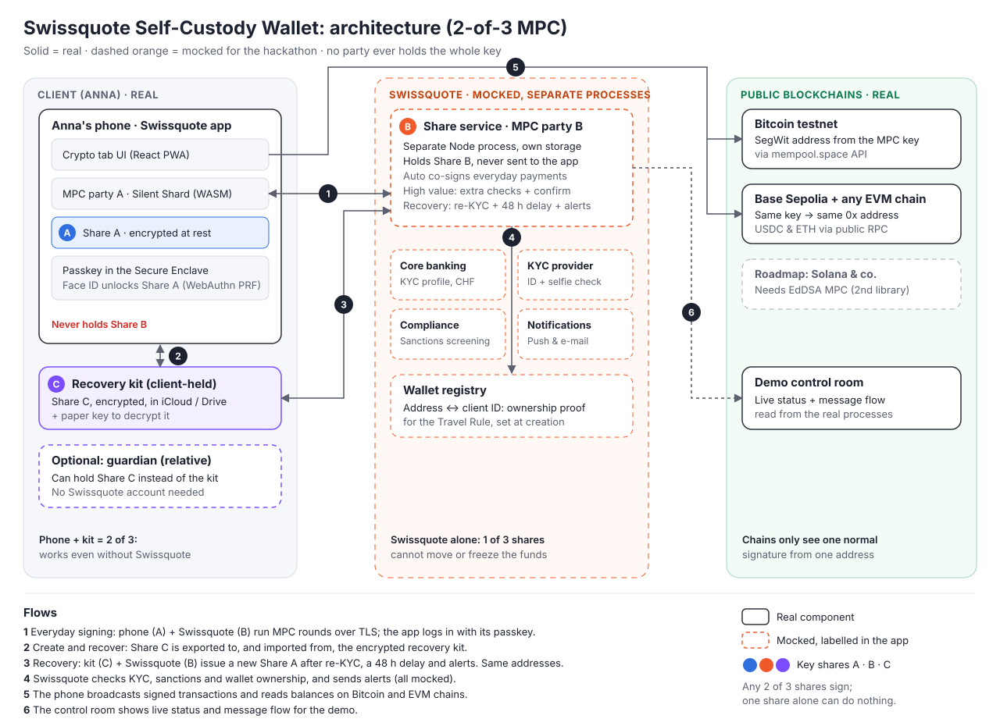

# Architecture

The wallet uses **2-of-3 threshold ECDSA (MPC)**. One key is generated in three shares: Anna's phone (A), the Swissquote share service (B) and a recovery kit she keeps herself (C). Any two shares sign together; the whole key never exists in one place. Because the result is an ordinary ECDSA signature, the same wallet works on Bitcoin and on every EVM chain.

## Components

| Component | Real or mocked | Role | What the real version would be |
|-----------|----------------|------|--------------------------------|
| Swissquote app, Crypto tab (`app/`) | **Real** | UI, runs MPC party A, broadcasts transactions | Same, inside the native Swissquote app |
| Share A + passkey | **Real** | Phone's share, encrypted at rest, unlocked by Face ID / fingerprint (WebAuthn PRF) | Same; native keychain on older devices without PRF |
| Recovery kit (Share C) | **Real** | Encrypted share file in the client's cloud drive, paper key to decrypt it | Same |
| Guardian app (Share C, optional) | Planned | A relative holds Share C instead of the kit; no Swissquote account needed | Small companion app |
| Share service (Share B) | **Mocked**, separate Node process with its own storage | Co-signs payments, enforces limits and the recovery policy | Swissquote service in an HSM / secure enclave |
| Core banking | Mocked | Client ID, KYC status, CHF account | Swissquote core banking |
| KYC provider | Mocked | ID + liveness selfie during recovery | Swissquote's existing video/ID verification |
| Compliance | Mocked | Sanctions screening of recipient addresses | Chainalysis, Elliptic or similar |
| Notifications | Mocked | Alerts when recovery starts or a high-value payment is requested | Push, e-mail, SMS |
| Wallet registry | Mocked | Binds wallet addresses to the client ID at creation (ownership proof for the Travel Rule) | Part of Swissquote's client database |
| Bitcoin testnet | **Real** | Signed SegWit transactions, balances via mempool.space API | Bitcoin mainnet |
| Base Sepolia (+ any EVM chain) | **Real** | Signed EVM transactions, USDC and ETH | Base / Ethereum mainnet and other EVM chains |
| Demo control room | **Real** (demo tool) | Shows live status and message flow of the real processes | Not part of the product |

The client app **never holds Share B**. Swissquote holds only one share and can neither move nor freeze funds on its own.

## Flows

1. **Wallet creation.** Anna opens the Crypto tab and confirms with Face ID. Phone (A), share service (B) and the kit party (C) run distributed key generation. Share A is encrypted with a key from her passkey; Share C is encrypted and saved to her cloud drive, with a paper key; Share B stays with the service. The wallet address is signed by the new key and stored in the wallet registry against her client ID.
2. **Authentication and everyday signing.** Face ID unlocks Share A. The app logs in to the share service with its passkey, then phone and service run the MPC signing rounds. The service co-signs automatically for normal payments and asks for an extra confirmation above a threshold. The phone broadcasts the signed transaction.
3. **Signing without Swissquote.** If the service refuses or is gone, Anna loads her kit (C) and signs with phone + kit. No Swissquote involvement.
4. **Recovery (phone lost).** On a new phone Anna loads her kit and passes re-KYC (ID + selfie). After a 48 h delay with alerts to all her channels, kit (C) and service (B) create a new Share A. The public key and all addresses stay the same. She stores a new kit and destroys the old one.
5. **Stolen phone.** Recovery as above, then an optional sweep to a brand-new key, which makes every old share worthless.

## Status

| Part | State |
|------|-------|
| 2-of-3 key generation, signing with every pair, lost-share recovery, Bitcoin + EVM signing | Validated in [`spikes/mpc`](../spikes/mpc/README.md) |
| Share service as separate process, browser MPC, kit export, recovery UI, control room | Next |
| App today | Swissquote app mock-up with a passkey smart-account wallet (EVM only), to be switched to MPC |
