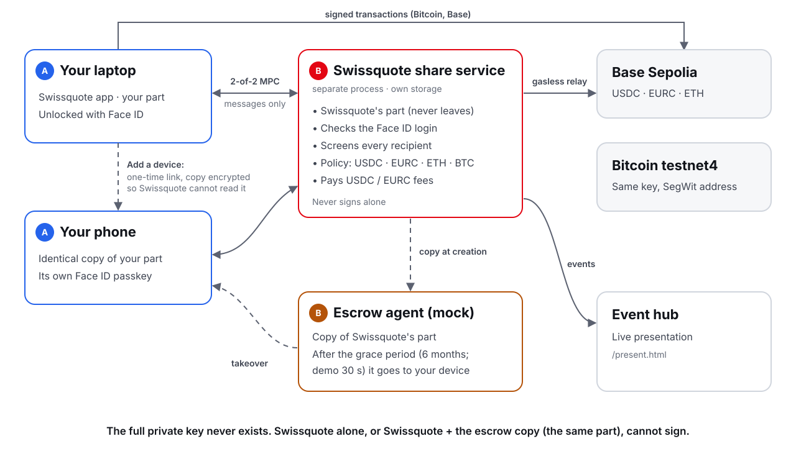

# Architecture

The wallet uses **two-party threshold ECDSA (MPC, 2-of-2)**. One key is generated in two parts: the client's part on their devices and Swissquote's part in its share service. Both parts sign together; the whole key never exists in one place. Because the result is an ordinary ECDSA signature, the same wallet works on Bitcoin and every EVM network.

## Components

| Component | Where | Role | Stores |
|---|---|---|---|
| **Wallet app** | `app/` (React, Vite; installable web app) | Swissquote app mock-up with the wallet in the Crypto tab. Runs party 0 of the MPC protocol, builds transactions, shows screening results, adds and removes devices | The client's part A and the device's passkey ID (browser storage) |
| **Share service** | `services/share-service.mjs`, port 8790 | Swissquote's backend (mock): party 1. Verifies passkeys, decodes and screens every payment, co-signs its own hash, relays add-a-device copies it cannot read, sponsors USDC/EURC fees | Part B, the wallet record (addresses, device passkeys), sponsoring counters (`services/data/share-service/`) |
| **Treasury** | `services/treasury.mjs` (inside the share service) | Swissquote's fee account on Base Sepolia: submits EIP-3009 authorizations, pays the gas | Its testnet key (`treasury-key.json`, git-ignored) |
| **Escrow agent** | `services/escrow-agent.mjs`, port 8791 | Independent notary (mock): holds a copy of part B and releases it to the client's device after the grace period | Copies of part B (`services/data/escrow-agent/`) |
| **Event hub** | `services/hub.mjs`, port 8787 | Collects events and streams them to the live presentation; watches the share service's health | Memory |
| **Live presentation** | `app/src/present/`, `/present.html` | Slides, live architecture view, activity feed, network graph | — |
| **Blockchains** | Base Sepolia, Bitcoin testnet4 | Settlement | — |

The Vite dev server proxies `/share`, `/escrow` and `/hub`, so the app, the presentation and the services share one origin (and one Cloudflare tunnel for phones). Passkeys are bound to that origin.

## Flows

**Create.** `POST /wallets` → passkey registration (Face ID) → `POST /wallets/:id/keygen/start` + 4 rounds on `POST /mpc/:sid`: the app runs party 0, the share service party 1. Both end with the same public key; part A stays on the device, part B in the service. The service derives the addresses, deposits a copy of B with the escrow agent and emits `wallet_created`.

**Pay.** The app screens the recipient (`POST /screen`), logs in with the passkey (`/auth/options`, `/login`: a token bound to one transfer), builds the transaction itself and calls `POST /wallets/:id/sign/start`. The service decodes it, screens again, checks the high-value rule and starts signing on **its own** hash; the app verifies the hash matches, completes 3 rounds and combines the signature, then broadcasts. For USDC/EURC the app signs an EIP-3009 authorization instead and `POST /wallets/:id/relay` has the treasury submit it.

**Add a device.** On a device with part A: Face ID → the app encrypts part A with a fresh random key and uploads the ciphertext (`POST /devices/invite`, single use, 10 minutes). The link `#add-device=<wallet>.<invite>.<key>` carries the key in the URL fragment, which browsers never send to servers. The new device registers its own passkey (`/devices/options`, `/devices/register`), receives the ciphertext and decrypts it locally.

**Remove a device.** `POST /devices/remove` from another logged-in device: the service drops that passkey and revokes its tokens.

**Grace period and takeover.** The escrow agent polls the share service's health. After `ESCROW_OUTAGE_SEC` of downtime (six months in production), `POST /wallets/:id/takeover/start` lets a device co-sign a one-time challenge with the escrow's copy of B; `POST /takeover/finish` verifies the signature against the wallet's public key, returns the copy and deletes it. The device then signs locally with both parts.

## Where the data lives

| Data | App (each device) | Share service | Escrow agent | Blockchain |
|---|---|---|---|---|
| Client's part A | ✔ | Only as ciphertext while a device is being added | | |
| Swissquote's part B | Only after a takeover | ✔ | Copy | |
| Public key, addresses | ✔ | ✔ | ✔ | Addresses |
| Passkey private keys | Device passkey manager | | | |
| Transactions | | | | ✔ |

## Building blocks

| Part | Choice |
|---|---|
| Threshold signatures | Silence Labs Silent Shard (DKLs23): `dkls-wasm-ll-web` in the app, `dkls-wasm-ll-node` in the services |
| Passkeys | SimpleWebAuthn (browser + server) |
| EVM | viem: transactions, EIP-712 / EIP-3009, Base Sepolia RPC |
| Bitcoin | @scure/btc-signer: SegWit transactions; mempool.space testnet4 API |
| Other networks' addresses | @scure/btc-signer, @scure/base, viem |
| Tokens | Circle test USDC `0x036C…CF7e` and EURC `0x8084…359F` on Base Sepolia |

## Status and evidence

| Part | State |
|---|---|
| Two-party key generation, passkey login, co-signing with decoding and screening | **Built**, covered by the service tests |
| Gasless USDC and EURC (EIP-3009 relay with daily cap) | **Built**, tested; live relays need a funded treasury |
| Adding and removing devices | **Built**, covered by the service tests and a headless browser run |
| Grace period and takeover | **Built**, tested end to end (Swissquote stopped, takeover, payment signed on the device alone) |
| Custody proof (Swissquote cannot sign alone) | Tests + `npm run insider` + *How my key works* in the app |
| Real broadcasts on Base Sepolia and Bitcoin testnet4 | **Built**; needs testnet funds in the wallet |
| Swissquote backend, KYC, list of malicious addresses, escrow agent | **Mocks** (labelled) |
