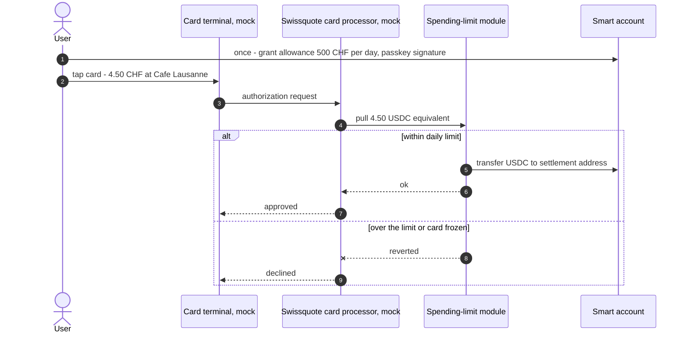

# Card payments from the self-custody wallet (optional feature)

Clients can pay with a Swissquote card directly from their self-custody wallet. Real-world precedents: Gnosis Pay (Visa card on a Safe account), MetaMask Card.

## The problem

A card payment must be approved within seconds at the terminal. The user can't sign an on-chain transaction with Face ID for every coffee. Someone has to be able to **pull** funds, which seems to contradict "Swissquote can never move client funds".

## The solution: a user-defined spending allowance

- The user grants the **Swissquote card settlement address** a spending allowance with their passkey, e.g. **max. 500 CHF in USDC per day**.
- On a card payment, Swissquote pulls the amount on-chain. The **smart contract** enforces the limit, not the bank.
- The user can **freeze the card instantly** (allowance set to 0) with one tap.
- **Raising** the limit is time-locked (48 h), like guardian changes. Lowering it or freezing is instant.
- A recovery (owner key rotation) automatically **resets the allowance to 0**.

So it stays self-custody: Swissquote can only spend within a limit the user sets and can revoke at any time.

## Weekend scope

| Part | Real or mock |
|------|--------------|
| Spending-limit module (daily USDC allowance, freeze, time-locked increase) | **Real**, on testnet |
| Card terminal ("Pay 4.50 CHF") | Mock UI in the browser |
| Card processor / Visa network / CHF-USDC FX | Mock backend, clearly labelled |

Demo: one payment within the limit goes through (real testnet tx), one over the limit is declined live, then the user freezes the card.

**Priority:** only after create → send → recover works. Same level as gasless; combines well with it (card settles in USDC, so the user never needs ETH).

## Why it matters

- **Business case:** interchange fees, daily use instead of a "vault" wallet, clients stay in the Swissquote ecosystem.
- **Security:** a stolen phone or card can lose at most the daily limit.
- **UX / pitch:** "paying for a coffee from your self-custody wallet" is a memorable demo moment.
