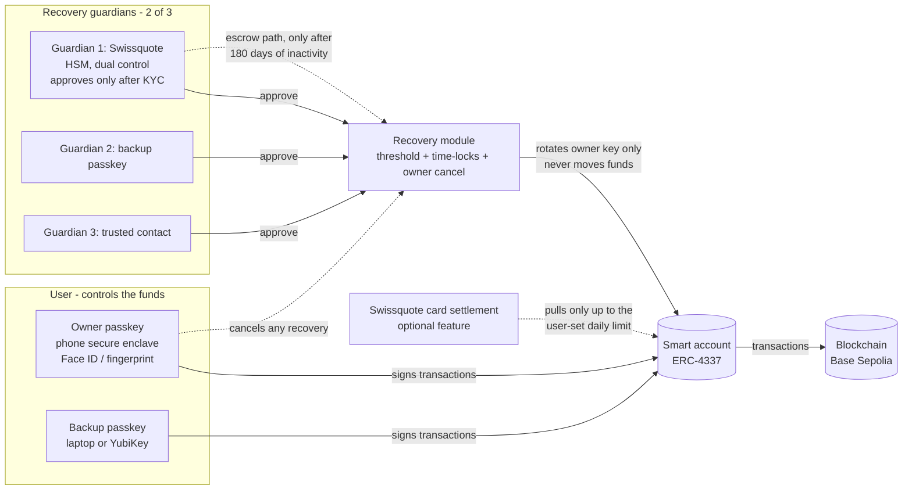

# Custody model

## Decision

**Self-custody smart account (ERC-4337) controlled by the user's passkey, with a two-path recovery module:**

1. **Guardian recovery:** 2 of 3 guardians approve a new owner key, followed by a **time-lock** during which the current owner can cancel.
2. **Time-delayed escrow (inactivity recovery):** only if the account has been **inactive for a long period**, Swissquote (as escrow agent) can propose a new owner after KYC re-verification, followed by a **long time-lock** during which any owner activity cancels it.

In both paths, recovery only **replaces the owner key**. No guardian, and not Swissquote, can ever transfer funds.

> One-line pitch: *Swissquote is the client's recovery partner, not their custodian.*

## Overview

Solid arrows: normal powers. Dotted arrows: restricted powers (owner veto, escrow path).

## Where do keys live?

| Key | Where it lives | Who controls it | What it can do |
|-----|----------------|-----------------|----------------|
| **Owner passkey** (P-256 / WebAuthn) | Secure enclave of the user's phone (synced passkeys are a user choice) | User, unlocked with Face ID / fingerprint | Sign every transaction. Cancel any pending recovery |
| **Backup passkey** (optional 2nd owner) | Second device: laptop, tablet or hardware key (YubiKey) | User | Same as the owner passkey. Covers "lost phone" without any recovery |
| **Guardian 1: Swissquote recovery key** | Swissquote HSM, dual control (2 employees needed) | Swissquote | Approve a recovery **after KYC re-verification of the client**. Start an inactivity recovery. **Cannot transfer funds** |
| **Guardian 2: Backup passkey** | As above | User | Approve a recovery |
| **Card settlement address** (optional) | Swissquote card processor | Swissquote | Pull USDC **only up to the daily limit the user set**. User can freeze instantly. Reset on recovery. See [`card-payments.md`](card-payments.md) |
| **Guardian 3: Trusted contact** | Wallet of a person the user chose (family member, friend, lawyer) | That person | Approve a recovery |

The private owner key **never leaves the user's device** and is never known to Swissquote. Swissquote stores only public data: the account address, public keys and the guardian configuration.

## Recovery parameters

| Parameter | Production value | Demo value |
|-----------|-----------------:|-----------:|
| Guardian threshold | 2 of 3 | 2 of 3 |
| Guardian recovery time-lock | 48 h | 2 min |
| Inactivity threshold before escrow path opens | 180 days | 5 min |
| Escrow recovery time-lock | 30 days | 3 min |
| Card daily limit (optional feature) | user-set, e.g. 500 CHF | 20 USDC |
| Time-lock for raising the card limit | 48 h | 1 min |

The user can change guardians and parameters, but each change is itself time-locked (48 h). An attacker with a stolen, unlocked phone therefore can't quietly swap the guardians.

## Can Swissquote move client funds alone?

**No**, with one user-controlled exception: if the user activates the optional card, Swissquote can spend **up to the daily limit the user set**, and the user can freeze it instantly.

- Swissquote's key is a guardian. It can only call recovery functions, never execute transfers.
- In guardian recovery, Swissquote is 1 of 2 required approvals.
- In inactivity recovery, Swissquote acts alone, but only:
  1. after the account has been inactive for 180 days,
  2. after KYC re-verification of the client (or their legal heirs),
  3. with a 30-day public time-lock, during which the owner is notified on all channels and any owner action cancels it.
- Every recovery step is an on-chain event, visible to the user and auditors.
- Users who want zero involvement from Swissquote can replace Guardian 1 with someone else and disable the escrow path.

## The three threat questions from the brief

| Question | Answer |
|----------|--------|
| **Who could steal funds?** | Only someone who controls the owner passkey (device + biometrics). A recovery-based theft needs 2 guardians **and** the owner ignoring alerts for 48 h. Card (optional): at most the daily limit |
| **Who could lock the client out?** | Nobody can freeze or block the account. Losing the device is covered by the backup passkey and guardian recovery. Guardians can't block the owner; they can only approve recoveries |
| **Could Swissquote move funds without the client?** | **Alone: no** (only 1 of 2 approvals; can't execute transfers). **With a partner** (e.g. the trusted contact): they could rotate the key, but only after a 48 h public time-lock in which the owner is alerted on all channels and can cancel. This is the residual grey zone; see the open decision below |

## If Swissquote disappears

The account is a contract on a public chain, so it does not depend on Swissquote:
- The owner passkey keeps working; the client can use any ERC-4337 / Safe-compatible interface and any public bundler.
- Recovery still works **without Swissquote**: backup passkey + trusted contact = 2 of 3.
- Only the escrow path (Path B) and the card stop working, which is acceptable.

## EVM-only?

ERC-4337 only exists on EVM chains (Ethereum, Base, Arbitrum, ...). For Bitcoin, the same model can be built natively with Miniscript: a primary key plus time-locked recovery keys (as used by the Liana wallet). The prototype focuses on EVM + USDC.

## Open decision: the escrow path and the custody grey zone

The legal primer says: if Swissquote can move funds **on its own**, it is custody. In Path B (inactivity recovery), Swissquote can rotate the owner key alone after 180 days of inactivity + 30 days time-lock. Even with the delays, a lawyer could argue that this is control by Swissquote.

Options:
1. **Swissquote + an independent partner** (e.g. a Swiss notary or inheritance partner) must both approve Path B. No single institution can act alone. *(Recommended)*
2. **Opt-in only:** Path B is off by default; clients who want the inheritance service activate it explicitly.
3. Combine 1 and 2.
4. Drop Path B and keep only guardian recovery.

Team decision: _TBD_

## Why this model (vs. the alternatives)

| Option | Why not (as the main model) |
|--------|-----------------------------|
| Swissquote holds the key (classic escrow / custody) | Not self-custody. A single insider or breach can drain funds. Becomes custody under Swiss rules |
| Seed phrase | Bad UX, and the #1 cause of lost funds. No way to distinguish the user from someone who stole the phrase |
| Shamir / SLIP-39 split backup | Better, but the full key is reassembled on a device during recovery, and there's no on-chain delay or veto |
| MPC / threshold signatures | Strong, but needs key-share servers and complex libraries. Recovery logic is off-chain and harder to audit |
| **Smart account + passkey + guardians + time-locks** | No seed phrase. Biometric signing. Recovery rules enforced on-chain and auditable. Owner can veto. Swissquote can never act alone or immediately. Enables gasless transactions and policy checks (bonus) |

## Building blocks (no custom cryptography)

- ERC-4337 smart account: Safe (+ Safe4337Module + passkey signer) or ZeroDev Kernel (+ WebAuthn validator). Decide at kickoff.
- P-256 signature verification: the account's audited verifier (RIP-7212 precompile where available).
- Recovery module: small contract with only **access-control and timing logic** (guardians, threshold, time-locks, cancel, inactivity). No cryptography of our own. If an audited module fits (e.g. an existing social-recovery module for Safe), we use that and only add the inactivity path.
- Bundler / paymaster: third-party (e.g. Pimlico).
