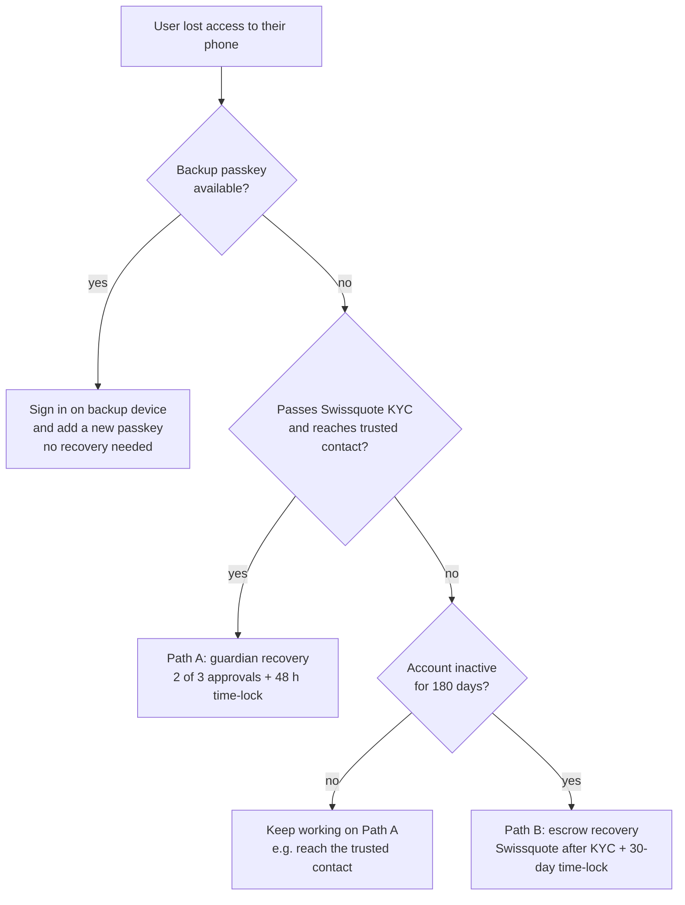
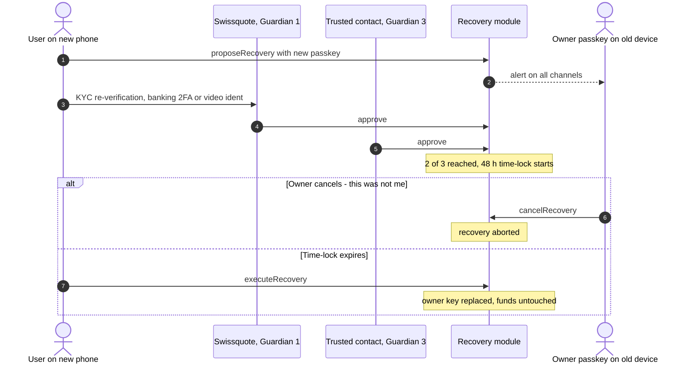
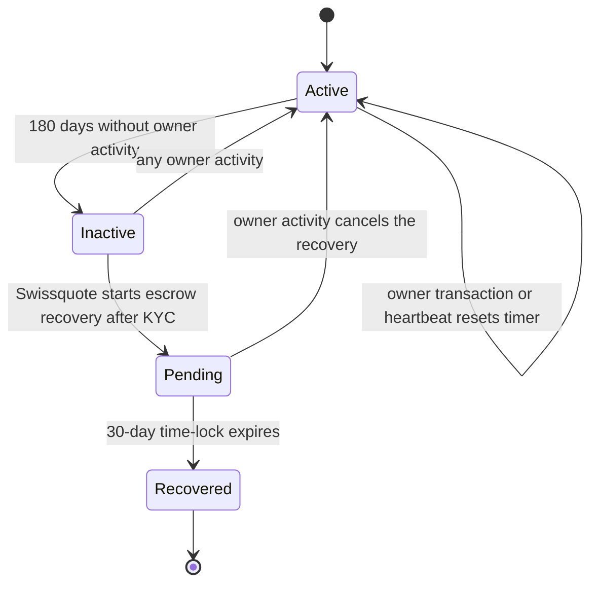
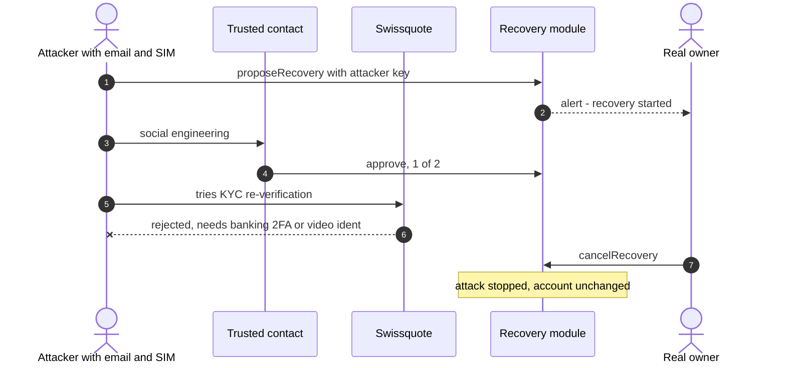

# Recovery

Recovery always means **rotating the owner key** to a new passkey. It never moves funds. Parameters are in [`custody-model.md`](custody-model.md#recovery-parameters).

## Scenarios

| Scenario | What the user does | Recovery path |
|----------|--------------------|---------------|
| Lost / broken phone, has backup passkey | Sign in on the backup device; add a new phone passkey | **None needed** |
| Lost phone, no backup device | Guardian recovery: Swissquote (after KYC) + trusted contact | Path A |
| Stolen phone | Phone is biometric-locked, so the thief can't sign. User starts guardian recovery to rotate the key | Path A |
| Phone **and** email/SIM compromised | Attacker can't recover without 2 guardians. If they start a recovery, the user cancels | Path A (defense) |
| **Swissquote is permanently gone** | Recover with backup passkey + trusted contact (2 of 3) through any Safe/4337 interface. The owner passkey keeps working anyway | Path A without Swissquote |
| User lost everything and is unreachable for months; death / inheritance | Swissquote verifies the client or heirs (KYC), starts escrow recovery | Path B |

## Which path applies?

## Path A: guardian recovery

1. **Start:** the user sets up a new passkey on a new device. The app creates a recovery request: "replace owner with this new key". The owner is alerted on all channels **as soon as a recovery is proposed**.
2. **Approvals:** 2 of 3 guardians approve on-chain.
   - Swissquote approves only after **KYC re-verification**: bank login with existing banking 2FA, plus video ident for higher-value accounts. *(mocked in the demo)*
   - Trusted contact approves in their own wallet (deep link).
   - Backup passkey approves, if available.
3. **Time-lock:** 48 h (demo: 2 min). Notifications go out on **all** channels: push, email, SMS, and the Swissquote app/e-banking.
4. **Cancel window:** the current owner passkey can cancel with one tap ("This wasn't me").
5. **Execute:** after the time-lock, anyone can execute. The new passkey becomes owner and the old one is removed.

## Path B: time-delayed escrow (inactivity recovery)

1. **Condition:** no owner activity for 180 days (demo: 5 min). Every owner-signed transaction, or a free "I'm still here" signature, resets the timer.
2. **Start:** Swissquote, after KYC re-verification of the client (or of the legal heirs with a certificate of inheritance), proposes a new owner key.
3. **Time-lock:** 30 days (demo: 3 min), with notifications on all channels throughout.
4. **Cancel:** any owner activity during the time-lock cancels the recovery.
5. **Execute:** after the time-lock, the new owner key is installed.

This is the "escrow" idea, but restricted: Swissquote can only act alone after a long silence, slowly, publicly, and with a veto for the real owner.

## Telling the real user apart from an attacker

The rule: **no single factor that an attacker typically gets (phone, email, SIM, one person) is enough, and the real owner always gets time and a veto.**

| Attacker has… | Can they recover? | Why not |
|---------------|-------------------|---------|
| Stolen, locked phone | No | Passkey needs biometrics. No guardian approves without the user |
| Phone + email + SIM (SIM swap) | No | Email/SMS are **not** guardians. Swissquote KYC needs banking 2FA / video ident. Trusted contact must approve too. Even with one approval, the owner sees alerts and cancels |
| Social-engineered trusted contact | No | That's only 1 of 2 approvals. Swissquote KYC still required. Owner can cancel |
| Malicious Swissquote insider | No | 1 guardian only in Path A. Path B needs 180 days of inactivity, then a 30-day public time-lock with owner veto. HSM dual control + audit log |
| Swissquote insider + trusted contact colluding | Can start, but **can't finish** | 48 h time-lock + alerts → the owner cancels |
| Attacker with an unlocked phone (coerced or shoulder-surfed) | Can sign transactions, but can't silently change guardians | Guardian/parameter changes are time-locked too. Optional: high-value limits (see compliance) |

### Example: attacker with the user's email and SIM

**Accepted risk:** a user who has lost every device, ignores all notifications for the full time-lock, and whose guardians collude can be attacked. The time-locks and multi-channel alerts make this very unlikely, and it's a strictly better position than a lost seed phrase.

## What Swissquote can and cannot do

| Swissquote **can** | Swissquote **cannot** |
|--------------------|------------------------|
| Verify the client's identity (KYC) as one recovery factor | Transfer, freeze or spend client funds |
| Approve a guardian recovery together with another guardian | Recover an account alone while the owner is active |
| Start an inactivity recovery after 180 days of silence | Skip or shorten a time-lock |
| Send recovery alerts on all channels | See or export the user's private key |
| Help heirs regain access (inheritance service) | Block the owner from cancelling a recovery |

## Demo script (recovery part)

1. User has a funded wallet on phone A.
2. **Attack:** "attacker" with the user's email starts a recovery to their own passkey. Gets one approval from a tricked trusted contact.
3. User gets an alert on phone A → taps **Cancel**. Recovery dead.
4. **Real loss:** user "loses" phone A. On phone B: new passkey → Swissquote KYC (mock) approves + trusted contact approves → 2-min time-lock → execute.
5. Phone B sends a transaction. **Done:** create → sign → lose → recover.
6. *(If time)* Path B: fast-forward the inactivity timer, Swissquote starts escrow recovery, show the cancel option.
