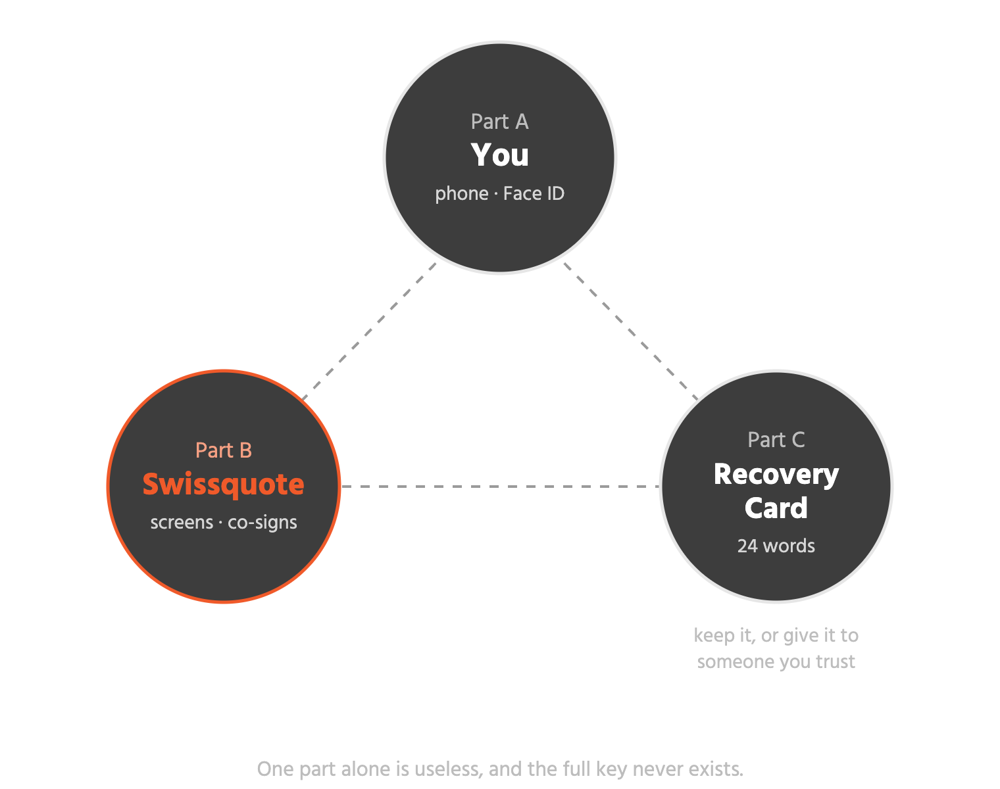
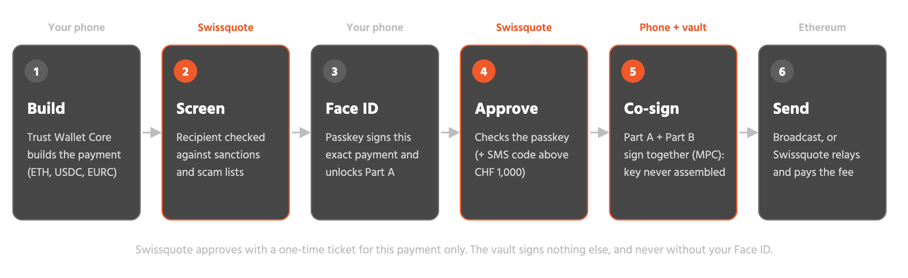
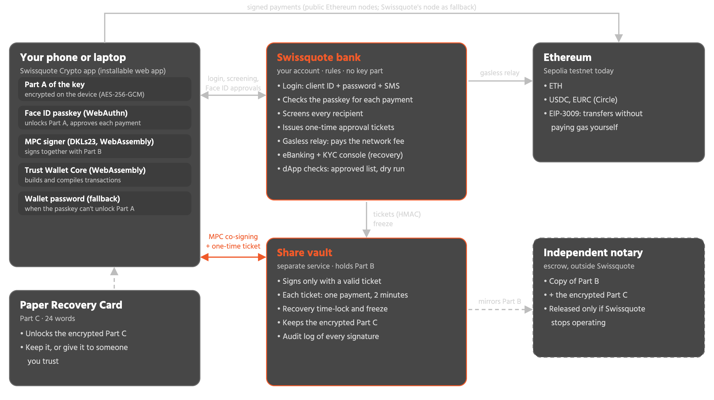
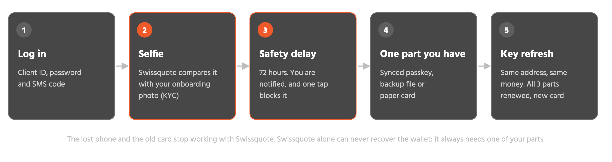

<!--
Technical part of the pitch deck. Every slide uses the deck's "Technical Part" header (light bar,
small kicker, title, Swissquote Crypto logo on the right) and the dark body with grey cards.
Orange (#f05a2a) marks Swissquote. Diagrams are in img/ as PNG (transparent, for PowerPoint)
and SVG (editable).

Convert to PowerPoint, using the existing deck as the template:
  cd pitch/tech
  pandoc tech-slides.md -o tech-slides.pptx --slide-level=2 --reference-doc=../YourDeck.pptx
Speaker notes are in the "::: notes" blocks and land in PowerPoint's notes field.
-->

## No single party can access or lose the wallet

:::::: {.columns}
::: {.column width="45%"}
**How the key is split**

:::
::: {.column width="55%"}
**Key features**

- 2-of-3 key parts (MPC): the full key is never assembled, not even to sign
- Libraries: Trust Wallet Core · DKLs23 MPC (Silence Laboratories) · WebAuthn passkeys · ethers.js
- Your parts A and C are stored only encrypted (AES-256-GCM); Swissquote relays copies it can't read
- Supported: ETH, USDC, EURC on Ethereum, plus a Bitcoin address from the same key
- Gasless USDC and EURC: Swissquote pays the network fee
- Safe DeFi: approved dApps only, dry run and plain-language effects before signing
- Recovery even if one part is lost: same address, all parts renewed
- Built for FINMA's Travel Rule: proof of ownership at setup, every recipient screened
:::
::::::

::: notes
The key exists as three parts. Part A is on your phone, Part B at Swissquote, Part C is locked by a paper Recovery Card that you keep or give to someone you trust. Any two parts can sign; one alone can do nothing. With MPC (DKLs23 threshold ECDSA), the two parts sign together without the full key ever existing anywhere, not even for a second. Trust Wallet Core builds and finishes every Ethereum transaction. Today it runs on the Sepolia testnet.
:::

## Every payment needs your Face ID and Swissquote

:::::: {.columns}
::: {.column width="50%"}
**Your half: Part A**

Locked on your phone. Only your Face ID opens it, and the same Face ID signs off on this exact payment: amount, recipient, asset.
:::
::: {.column width="50%"}
**Swissquote's half: Part B**

Released for one payment only, after the screening passes and your Face ID checks out. The ticket is valid for 2 minutes and can't be reused.
:::
::::::

::: notes
This is the "half Swissquote, half you" in practice. 1: the app builds the payment with Trust Wallet Core. 2: Swissquote screens the recipient against sanctions and scam lists; a blocked address is refused before anything is signed. 3: Face ID does two things at once: the passkey unlocks Part A on the phone, and it signs a challenge that contains this exact payment. 4: Swissquote verifies that signature, asks for an SMS code above CHF 1,000 (CHF 20 in the demo), and issues a one-time ticket for this payment's hash. 5: the phone and Swissquote's vault run the MPC signing together; the vault refuses any other hash. 6: the payment goes to Ethereum. For USDC and EURC, the wallet signs an EIP-3009 authorization instead, and Swissquote submits it and pays the gas.
:::

## Three locks, each with its own job

| Lock | What it is | What it opens | Stolen on its own |
|---|---|---|---|
| **Swissquote login** | Client ID + password + SMS code | Your account: set up the wallet, add a device, request a recovery | Can't move money: no key part |
| **Face ID** (passkey) | Built into your phone, never leaves it | Unlocks Part A and approves each payment | Useless without your phone |
| **Wallet password** (fallback) | For phones whose passkey can't unlock Part A | Unlocks Part A (600,000 PBKDF2 rounds slow down guessing) | Useless without your phone; Face ID still approves payments |

::: notes
Three different checks, so no single stolen secret is enough. The Swissquote login is what you already use for eBanking: it proves who you are to the bank, but it never touches the key. Face ID is a passkey: the phone derives an encryption key from it (WebAuthn PRF) that opens Part A, so there is nothing to remember and nothing to guess. On phones whose passkey can't do that (older iOS, many Windows Hello setups), the app asks for a wallet password instead and stretches it with 600,000 PBKDF2 rounds. Even then, every payment is still approved with the passkey.
:::

## What would an attacker need?

:::::: {.columns}
::: {.column width="50%"}
**Steals your phone**

Needs your Face ID too. You remove the phone from another device in one tap, and Swissquote stops accepting it.

**Steals your password and SIM**

Can log in, but can't sign. A recovery needs your face, waits 72 hours, and you are alerted and can block it.
:::
::: {.column width="50%"}
**Hacks Swissquote**

Gets Part B and encrypted copies only. Without your phone or your card, nothing can be signed.

**Finds your Recovery Card**

That's one part. A payment still needs your phone, or Swissquote after a full identity check.
:::
::::::

::: notes
Every attack needs two independent things: something only you have (phone, card) and either Swissquote's co-signature (screening, Face ID, identity check, time-lock) or a second thing only you have. Swissquote alone can never move or recover the money.
:::

## How the whole system connects

::: notes
Four parts. The app on your phone or laptop holds Part A, the Face ID passkey, the MPC signer and Trust Wallet Core, all in the browser (WebAssembly), installable on the iPhone home screen. The Swissquote bank handles your login, screening and approvals. It holds no key part, it only issues signed one-time tickets. The share vault is a separate service holding Part B; it signs only with a valid ticket and enforces the recovery delay and freezes. An independent notary keeps a copy of Part B and the encrypted Part C, released only if Swissquote stops operating. Signed payments go straight to public Ethereum nodes.
:::

## Lose your phone, keep your wallet

::: notes
Recovery uses key refresh: the parts you still have and Swissquote's vault create three new parts for the same key. The address and the money stay the same; the lost phone's copy of Part A and the old Recovery Card no longer work with Swissquote. (An old A and an old card together still form the same key; if both could be stolen, moving to a new wallet closes that.) The 72-hour delay (15 seconds in the demo) is the window in which the real owner gets an alert and can block an impostor with one tap. Swissquote can't do this alone: it always needs one part from you.
:::

## Safe DeFi: Swissquote checks every app request

:::::: {.columns}
::: {.column width="50%"}
**Before you sign**

- Only apps on Swissquote's approved list (WETH, Uniswap)
- Swissquote decodes the request: no hidden actions
- Dry run on the network: you never pay for a failure
- What will happen, in plain words: "0.01 ETH leaves, 0.01 WETH arrives"
:::
::: {.column width="50%"}
**Refused before anything is signed**

- Unknown contracts
- "Unlimited access to your USDC", the classic wallet drainer
- Sanctioned contracts or spenders
- From CHF 1,000: Face ID plus an SMS code
:::
::::::

::: notes
This is the compliant dApp bonus. The Apps screen wraps ETH into WETH as the approved example. Every request goes to Swissquote's /dapps/simulate: the bank decodes it with the dApp's ABI, checks the approved list and sanctions, runs eth_call on Sepolia and returns the effects in plain language. Only then does the client approve with Face ID, and the vault co-signs that exact transaction. The demo buttons show a scam request (unlimited USDC approval to an unknown app) being refused.
:::

## You are never locked in

:::::: {.columns}
::: {.column width="50%"}
**Swissquote is offline**

Your phone signs with Part A + your Recovery Card. No screening, no free transfers, but your money moves.
:::
::: {.column width="50%"}
**Swissquote closes for good**

The independent notary releases its copy of Part B. Our open-source tool moves everything to a new wallet with any two parts.
:::
::::::

::: notes
Self-custody means Swissquote must not become a single point of failure. If the bank can't be reached, the app offers "Continue without Swissquote": Part A and Part C sign on the phone. If Swissquote ceased operating, the notary's copy of Part B plus your card or backup file is enough. The tool (npm run recover-offline) does this without any Swissquote server.
:::

## What we built, and what is mocked

:::::: {.columns}
::: {.column width="50%"}
**Real**

- 2-of-3 MPC key: creation, signing, recovery with key refresh
- Face ID passkeys, devices with identical copies of Part A
- Transactions built by Trust Wallet Core, live on Ethereum Sepolia
- Gasless USDC and EURC, paid by Swissquote's fee account
- Screening, SMS for large payments, limits, time-lock, freeze
- dApp checks: approved list, dry run on Sepolia, no unlimited approvals
:::
::: {.column width="50%"}
**Mocked for the demo**

- Swissquote's bank backend, login and SMS
- Identity check (KYC operator console)
- Sanctions list
- Notary escrow

**Tested:** 15 end-to-end API tests and 2 full browser runs with a virtual Face ID
:::
::::::

::: notes
Everything that touches the key and the blockchain is real code running on a public testnet. What a bank already has (login, SMS, KYC, sanctions data) is mocked with the same interfaces. The tests create wallets, co-sign real transactions, block sanctioned payments, add and remove devices, and recover wallets with each of the three recovery paths.
:::
